# Aurora Soberana

<p align="center"></p>

**Impulso Digital Soluções em IA** · Python · governança · XAI · auditoria · CPU-first

Núcleo executável local para avaliação de políticas de acesso e registro verificável de decisões. A implementação adota negação por padrão, regras explícitas e trilha de auditoria encadeada por SHA-256.

## Instalação e testes

```bash
python -m venv .venv
source .venv/bin/activate
python -m pip install -e ".[dev]"
pytest -q
```

## Exemplo

```python
from aurora_soberana import AuroraGovernance, Policy, RequestContext

policy = Policy(
    allowed_actors=frozenset({"operador"}),
    allowed_actions=frozenset({"consultar"}),
    allowed_resources=frozenset({"relatorio-publico"}),
)
engine = AuroraGovernance(policy)
decision = engine.evaluate(RequestContext(
    actor="operador",
    action="consultar",
    resource="relatorio-publico",
    purpose="consulta demonstrativa",
))
print(decision.to_dict())
print("Auditoria íntegra:", engine.verify_audit_chain())
```

## Controles implementados

- Política restritiva por padrão, sem permissões implícitas.
- Verificação de ator, ação, recurso, finalidade e classificação.
- Referência de consentimento exigida para categorias pessoais/sensíveis quando habilitada.
- Registro de decisões sem guardar payloads ou conteúdo pessoal.
- Encadeamento SHA-256 com verificação de integridade em memória.
- Testes unitários e CI para Python 3.11.

## Limitações e implantação

O ledger é mantido em memória e não é armazenamento imutável, assinatura digital ou prova externa. A política é configurada em código e ainda não possui painel administrativo, persistência transacional, autenticação de usuários, gestão de chaves ou integração com provedores de identidade. Antes de qualquer uso compartilhado, implemente persistência protegida, autenticação, gestão de segredos, revisão de ameaças, retenção e testes de carga. Não use como infraestrutura crítica ou serviço certificado.


## Fluxo passo a passo

Consulte o [guia textual com as etapas do projeto](docs/PROCESSO-PASSO-A-PASSO.md). O infográfico acima resume visualmente o mesmo fluxo.
