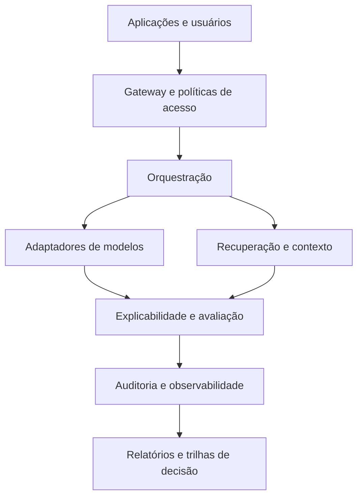

# Aurora Soberana | Núcleo conceitual de inteligência artificial

Repositório inicial para organizar a visão, os requisitos e a evolução técnica do projeto Aurora Soberana, uma iniciativa conceitual da Impulso Digital voltada a sistemas de IA com governança, rastreabilidade, explicabilidade e controle responsável de dados.

> **Maturidade:** documentação de arquitetura em desenvolvimento. No momento deste commit, o repositório não contém implementação executável. As capacidades descritas nesta página são objetivos de projeto, não funcionalidades disponíveis ou validadas.

## Objetivos

- Definir uma arquitetura modular para serviços de IA.
- Documentar entradas, saídas, dependências e limites de cada módulo.
- Incorporar práticas de explicabilidade (XAI), avaliação e rastreabilidade.
- Planejar controles de privacidade, segurança e governança de dados.
- Permitir validação incremental por testes reproduzíveis.

## Arquitetura de referência proposta

A arquitetura abaixo é um ponto de partida para discussão e não representa componentes já implementados.

## Princípios de engenharia

1. **Segurança por padrão:** segredos fora do código, permissões mínimas e validação de entradas.
2. **Privacidade:** minimizar dados coletados e documentar retenção e finalidade.
3. **Explicabilidade:** registrar evidências, incertezas e limites das respostas.
4. **Modularidade:** interfaces explícitas e componentes testáveis isoladamente.
5. **Reprodutibilidade:** versões fixadas, testes automatizados e instruções claras.
6. **Transparência:** distinguir protótipo, experimento e produção.

## Plano inicial

- [ ] Definir casos de uso e requisitos não funcionais.
- [ ] Escolher linguagem, runtime e estrutura de pacotes.
- [ ] Especificar contratos de API e modelo de ameaças.
- [ ] Criar um primeiro módulo executável com testes.
- [ ] Adicionar CI, análise estática e política de segurança.
- [ ] Publicar benchmarks e documentação de limitações.

## Como usar

Ainda não há instalação ou execução disponível. Acompanhe este README e o histórico de commits para identificar quando um primeiro componente executável for publicado.

## Contribuição

Issues e pull requests devem descrever contexto, comportamento esperado, riscos e evidências de validação. Não publique credenciais, dados pessoais ou informações restritas.

## Licença

Nenhuma licença foi definida neste commit. Não presuma permissão de reutilização até que um arquivo de licença seja adicionado.

**Empresa responsável:** Impulso Digital Soluções em IA.
